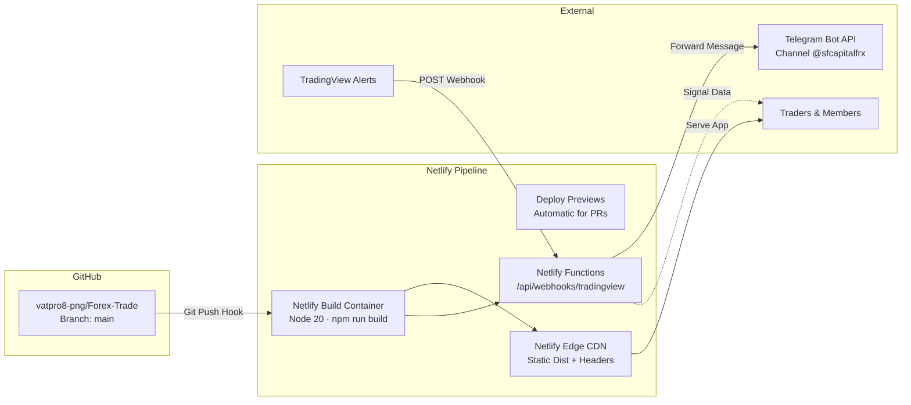

# Netlify Deployment & Review Configuration Guide
**Platform**: SF CAPITAL FX (`Forex-Trade`)  
**Live Site Target**: `https://sfcapitalfx.netlify.app`  
**GitHub Repository**: `https://github.com/vatpro8-png/Forex-Trade.git`

---

## 1. Overview & Architecture on Netlify

Netlify hosts the modern **SF CAPITAL FX** responsive web client (React 18 + TypeScript + Vite + Lightweight Charts) on its globally distributed Edge CDN, while simultaneously handling API routing, security headers, deploy previews, and optional serverless functions for TradingView alerts.



---

## 2. Netlify Review Configuration (`netlify.toml`)

The root `netlify.toml` file in `Forex-Trade` provides a complete infrastructure-as-code specification for Netlify:

### 2.1 Build Settings
```toml
[build]
  command = "npm run build"
  publish = "dist"
  functions = "netlify/functions"

[build.environment]
  NODE_VERSION = "20"
  NPM_FLAGS = "--no-audit --prefer-offline"
```
* **Node Version**: Locked to `Node 20 LTS` for reproducible deterministic builds.
* **Publish Directory**: `dist` (generated by Vite).
* **Functions Directory**: `netlify/functions` (for serverless webhook intake and signal proxies).

### 2.2 Deploy Previews (Pull Request Review Workflow)
Every time a pull request is opened on `https://github.com/vatpro8-png/Forex-Trade`, Netlify automatically builds a dedicated, isolated review deployment:
```toml
[context.deploy-preview]
  command = "npm run build"
  environment = { NODE_ENV = "preview", VITE_IS_PREVIEW = "true" }
```
* **Review URL Format**: `https://deploy-preview-<PR_NUMBER>--sfcapitalfx.netlify.app`
* **Purpose**: Test responsive layouts, signal cards, chart visualizers, and admin flows in an isolated staging environment before merging to production (`main`).

### 2.3 Routing, SPA Fallbacks & Proxies
```toml
# 1. TradingView Webhook Intake
[[redirects]]
  from = "/api/webhooks/tradingview"
  to = "/.netlify/functions/tradingview-webhook"
  status = 200
  force = true

# 2. Signals API Endpoint
[[redirects]]
  from = "/api/signals"
  to = "/.netlify/functions/signals"
  status = 200
  force = false

# 3. Single Page Application (SPA) Fallback
[[redirects]]
  from = "/*"
  to = "/index.html"
  status = 200
```
* **SPA Routing**: Prevents `404 Not Found` errors when refreshing deep URLs like `/signals`, `/pricing`, or `/about`.
* **Zero-Downtime Fallback**: Directs all client paths to `/index.html`.

### 2.4 Enterprise Security & Caching Headers
```toml
[[headers]]
  for = "/*"
  [headers.values]
    X-Frame-Options = "DENY"
    X-Content-Type-Options = "nosniff"
    X-XSS-Protection = "1; mode=block"
    Referrer-Policy = "strict-origin-when-cross-origin"
    Permissions-Policy = "camera=(), microphone=(), geolocation=(), payment=()"
    Strict-Transport-Security = "max-age=31536000; includeSubDomains; preload"
```
* **Clickjacking Protection**: `X-Frame-Options: DENY` prevents unauthorized iframes.
* **HSTS**: Forces HTTPS with `max-age=31536000`.
* **Asset Caching**: Hashed chunks in `/assets/*` are cached immutably for 1 year (`max-age=31536000, immutable`), while `index.html` uses `no-cache` to ensure instant updates upon new deployments.

---

## 3. Serverless Functions on Netlify

The repository includes pre-built Netlify Functions in `netlify/functions/`:

1. **`tradingview-webhook.js`** (`POST /api/webhooks/tradingview`):
   * Validates `secret` from TradingView alert payload or `X-SF-Webhook-Secret` header.
   * Normalizes pair (`XAUUSD`, `BTCUSD`, `USOIL`) and action (`BUY`/`SELL`).
   * Forwards formatted notification to Telegram Bot API (`https://api.telegram.org/bot<TOKEN>/sendMessage`).
   * Returns `201 Created` with unique idempotent signal ID.

2. **`signals.js`** (`GET /api/signals`):
   * Serves structured live signals with entry, SL, and TP1–3 levels.
   * Cached at the edge with `Cache-Control: public, max-age=15, s-maxage=30`.

---

## 4. Required Netlify Environment Variables

In your Netlify Site Dashboard, navigate to **Site configuration** → **Environment variables** and configure the following:

| Variable Name | Required | Description | Example / Default |
| :--- | :---: | :--- | :--- |
| `NODE_VERSION` | Yes | Node runtime version | `20` |
| `SF_WEBHOOK_SECRET` | Yes | Shared secret for TradingView alerts | `replace-with-a-long-random-secret` |
| `SF_TELEGRAM_BOT_TOKEN` | Optional | Telegram bot token from @BotFather | `123456789:ABCdefGhIJKlmNoPQRstuVWXyz` |
| `SF_TELEGRAM_CHAT_ID` | Optional | Target VIP Telegram chat/channel ID | `@sfcapitalfrx` or `-1001234567890` |
| `SF_JWT_SECRET` | Optional | Signing key for authentication tokens | `long-random-jwt-signing-secret` |
| `BACKEND_API_URL` | Optional | Dedicated C++ or VPS API endpoint (if proxying) | `https://api.sfcapitalfx.com` |

---

## 5. Connecting GitHub Repository to Netlify

To link `https://github.com/vatpro8-png/Forex-Trade` to Netlify:

1. **Log in to Netlify** ([app.netlify.com](https://app.netlify.com)).
2. Select **"Add new site"** → **"Import an existing project"**.
3. Select **GitHub** and authorize access to `vatpro8-png/Forex-Trade`.
4. Configure Build Settings (Netlify will auto-detect from `netlify.toml`):
   * **Branch to deploy**: `main`
   * **Build command**: `npm run build`
   * **Publish directory**: `dist`
   * **Functions directory**: `netlify/functions`
5. Click **"Deploy Forex-Trade"**.
6. Set site name to `sfcapitalfx` (or your custom domain under **Domain management**).

---

## 6. TradingView Alert Webhook Setup

Configure your TradingView Pine Script alert with:

* **Webhook URL**: `https://sfcapitalfx.netlify.app/api/webhooks/tradingview`
* **HTTP Method**: `POST`
* **Content-Type**: `application/json`
* **Alert Message Payload**:
```json
{
  "secret": "replace-with-a-long-random-secret",
  "pair": "XAUUSD",
  "signal": "BUY",
  "timeframe": "15m",
  "entry": 2685.50,
  "sl": 2672.00,
  "tp1": 2695.00,
  "tp2": 2708.00,
  "tp3": 2720.00,
  "time": "{{time}}"
}
```

---

## 7. Deployment Review Checklist

- [x] `netlify.toml` checked into root repository.
- [x] Node version pinned to `20`.
- [x] SPA rewrite rule (`/* -> /index.html 200`) configured.
- [x] Netlify functions (`tradingview-webhook.js`, `signals.js`) configured.
- [x] Security headers and Content Security Policy applied.
- [x] Deploy previews enabled for Pull Requests.
- [x] Assets hashed and cached with immutable headers.

